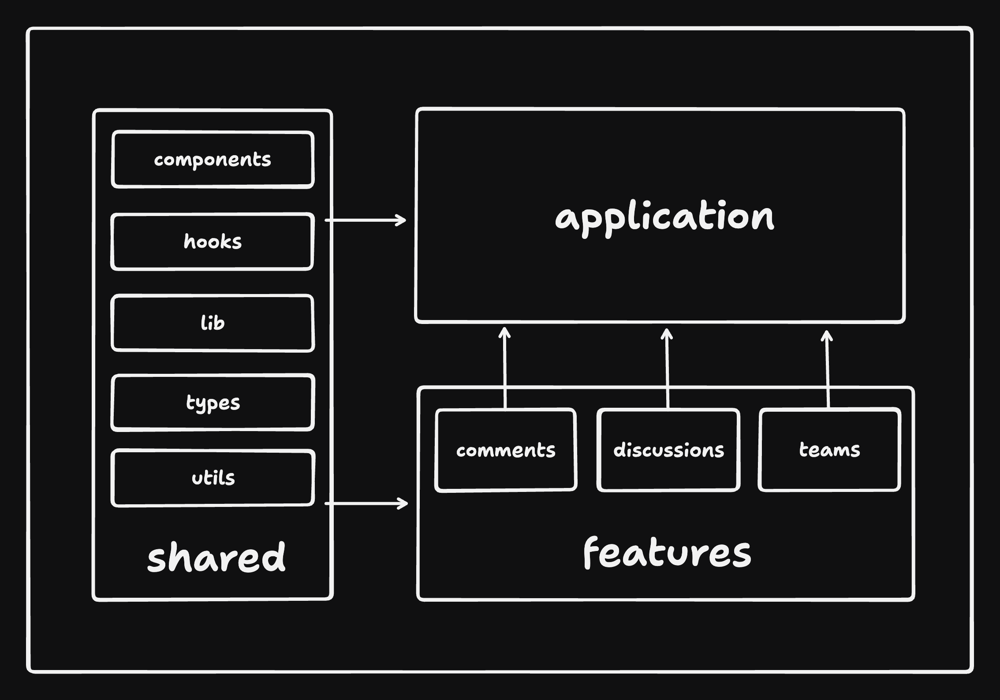

# 🗄️ Project Structure

This is the most important chapter. Everything else — the API layer, testing, state — hangs off this structure.

## The problem this structure solves

Most React tutorials organize code **by file type**:

```
src/
  components/     # 200 components from every part of the app
  hooks/          # 60 hooks, no idea which feature uses which
  utils/
```

This works for a to-do app and collapses at scale. Symptoms you'll recognize from real jobs:

- You need to change the "discussions" feature and the relevant code is scattered across five top-level folders.
- Deleting a feature is terrifying because you can't tell what's safe to remove.
- Every folder grows forever; nothing is ever obviously "done" or self-contained.

Bulletproof React instead organizes **by feature**, with a thin shared layer underneath and a thin app layer on top.

## The top-level layout

From [`apps/react-vite/src`](../apps/react-vite/src):

```sh
src
|
+-- app/          # application layer
|   +-- routes/       # route components (pages)
|   +-- app.tsx       # root application component
|   +-- provider.tsx  # wraps the app in global providers (query client, error boundary, ...)
|   +-- router.tsx    # route configuration
|
+-- assets/       # static files (images, fonts)
+-- components/   # SHARED components used across the whole app (buttons, dialogs, form fields)
+-- config/       # global config, parsed env variables
+-- features/     # 🔑 feature modules — most code lives here
+-- hooks/        # SHARED hooks
+-- lib/          # preconfigured libraries (api client, react-query config, auth)
+-- stores/       # global state stores (only if truly global)
+-- testing/      # test utilities and MSW mocks
+-- types/        # shared types (the API data model)
+-- utils/        # shared pure functions
```

Note what `components/`, `hooks/`, and `utils/` mean here: **shared across features**. If something is only used by discussions, it does *not* go here — it goes inside `features/discussions/`.

## Inside a feature

Each folder in `features/` is a self-contained module. From this repo:

```sh
src/features/discussions
|
+-- api/          # fetchers + react-query hooks for this feature (get-discussions.ts, create-discussion.ts, ...)
+-- components/   # components only this feature uses (discussions-list.tsx, create-discussion.tsx, ...)
```

A feature *may* also have `assets/`, `hooks/`, `stores/`, `types/`, `utils/` — **only create the folders you need**. Compare [`features/discussions`](../apps/react-vite/src/features/discussions) (api + components) with [`features/auth`](../apps/react-vite/src/features/auth) — they have different shapes because they need different things.

The test of a good feature folder: **could you delete it with one `rm -rf` and only break that feature?** In this codebase, yes.

## The two import rules

Structure only works if imports respect it. There are two rules, both machine-enforced.

### Rule 1: Features don't import from each other

`features/discussions` must not import from `features/comments`. If discussions need to render comments, the **app layer** composes them:

```tsx
// app/routes/app/discussions/discussion.tsx (the route composes two features)
import { DiscussionView } from '@/features/discussions/components/discussion-view';
import { Comments } from '@/features/comments/components/comments';
```

**Why?** The moment features import each other, they stop being independent modules and become one tangled module with extra folders. Cross-feature knowledge belongs to the layer above — the app — which is *supposed* to know about everything.

### Rule 2: Imports flow in one direction

```
shared (components, hooks, lib, types, utils)
   ↓  may be imported by
features
   ↓  may be imported by
app
```

- Shared code imports **nothing** from features or app.
- Features import shared code, never app code, never other features.
- App imports anything.



**Why?** When you open any file, you instantly know what it's allowed to depend on. Refactors stay local. Circular dependencies — the classic cause of "why is this import `undefined`?" bugs — become structurally impossible.

### Enforcement

Rules that rely on discipline die in the second sprint. Both rules are ESLint errors via `import/no-restricted-paths` — see the real config in [`.eslintrc.cjs`](../apps/react-vite/.eslintrc.cjs):

```js
'import/no-restricted-paths': [
  'error',
  {
    zones: [
      // Rule 1 — cross-feature imports are errors:
      { target: './src/features/auth', from: './src/features', except: ['./auth'] },
      { target: './src/features/comments', from: './src/features', except: ['./comments'] },
      // ...one zone per feature

      // Rule 2 — unidirectional flow:
      // app may import features, not the reverse
      { target: './src/features', from: './src/app' },
      // features/app may import shared modules, not the reverse
      {
        target: ['./src/components', './src/hooks', './src/lib', './src/types', './src/utils'],
        from: ['./src/features', './src/app'],
      },
    ],
  },
],
```

Read the zone syntax carefully — it trips people up: `target` is the code being *protected from* imports, `from` is who's forbidden to be imported by it. "`target: './src/features/auth', from: './src/features', except: ['./auth']`" means: *files in `features/auth` may not import from `features/` — except from `auth` itself.*

## Two practical footnotes

- **Barrel files (`index.ts` re-exports) are no longer recommended.** They used to be the suggested "public API" of a feature, but they break Vite's tree-shaking and slow builds. Import files directly: `@/features/discussions/api/get-discussions`.
- **A shared `api/` folder is a valid alternative** to per-feature `api/` folders when many features share the same endpoints. Default to per-feature; centralize only when duplication actually hurts.

## Common junior mistakes

1. **Putting everything in shared `components/` "just in case."** Start inside the feature. Promote to shared only when a *second* feature genuinely needs it. Premature sharing is how god-folders form.
2. **Creating all seven feature subfolders on day one.** Empty structure is noise. Add folders when files exist to fill them.
3. **Sneaking a cross-feature import "just this once."** That's what the lint rule is for. If you're fighting it, the fix is usually: move the shared piece down to `components`/`lib`, or compose at the app layer.
4. **Deep relative imports** (`../../../components/button`). Use the `@/` alias — see [Project Standards](03-project-standards.md).

## Try it yourself

1. In `react-vite`, add `import { Comments } from '@/features/comments/components/comments';` to a file in `features/discussions` and run `yarn lint`. Read the error it produces — that message is the architecture defending itself.
2. Trace how the discussion page composes discussions + comments: start at [`app/router.tsx`](../apps/react-vite/src/app/router.tsx), follow it to the discussion route, and note which layer imports which feature.
3. Sketch (on paper) the feature folder you'd add for a "notifications" feature: which subfolders would it need, and what would live in shared vs. the feature?
